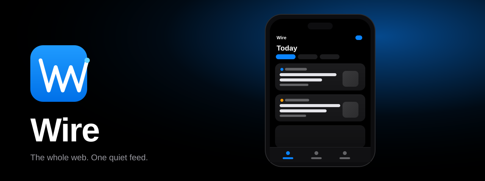

<div align="center">



# Wire

**An iOS-style Android news reader for RSS/Atom — endless, swipeable, quiet.**

[](https://github.com/dune-ai-test/news-rss-app/actions/workflows/android.yml)


</div>

---

## ✨ What is Wire?

Wire turns the RSS universe into a calm, social-media-style timeline. It looks and
feels like a polished iOS app — large titles, frosted navigation bars, iOS system
colors, grouped inset lists, segmented controls, switches — but it is a **100%
native Android app** built with Kotlin + Jetpack Compose.

No ads. No accounts. No tracking. Just your feeds, beautifully rendered.

## 📱 Features

- **Twitter/X-style infinite timeline** — nothing between you and the news:
  big round source avatars, **verified** badges, `@handles`, bold headlines,
  gray preview text, full-width rounded media when a story has one (pure text
  otherwise), hairline dividers — with pull-to-refresh and endless scroll
  ending in *"All caught up"*.
- **In-app Reader view** — a Safari-Reader-style experience: serif typography,
  generous margins, hero image, reading time, estimated progress, `Aa` text-size
  cycler, and end-of-article marker. Extraction is readability-style (Jsoup +
  paragraph-density heuristics) with a fallback to the original site.
- **Bookmarks & offline reading** — save any story; it's stored in Room and readable
  without a network connection. Swipe-to-delete with an Undo snackbar, iOS style.
- **30+ curated sources in 7 desks** — Top Stories, World, Technology, Science,
  Business, Sports, Culture. Every source is toggleable, and you can **add your own
  RSS/Atom feeds** from inside the app.
- **iOS design language, pixel-tuned** — iOS system blue (`#007AFF` / `#0A84FF`),
  SF-style tight tracking, large-title navigation that collapses into the nav bar on
  scroll, hairline separators, grouped inset settings, switches, segmented controls,
  and an adaptive launcher icon.
- **Dark mode** — System / Light / Dark segmented control in Settings, fully themed.
- **Offline cache** — your timeline is cached on-device; when the network drops,
  Wire shows cached stories with an iOS-style offline banner.
- **Share anywhere** — Android share sheet with one tap, plus Chrome Custom Tabs for
  "Read original".

## 🖼️ Screens

| Today (Feed) | Reader | Saved | Sources | Settings |
|---|---|---|---|---|
| Large-title "Today" + sticky category chips | Serif reader with `Aa`, share & bookmark | Swipe-to-delete, Undo snackbar | Grouped by desk, iOS switches, add custom feeds | Appearance / Storage / About |

## 🏗️ Tech stack

| Layer | Choice |
|---|---|
| Language | Kotlin 1.9 |
| UI | Jetpack Compose (Material 3, iOS-themed) |
| Min / Target SDK | 26 / 34 |
| Architecture | MVVM + manual DI (`AppContainer`) |
| Persistence | Room (article cache, bookmarks, custom feeds) + DataStore (settings) |
| Networking | OkHttp |
| Feed parsing | Hand-rolled RSS 2.0 / Atom parser (XmlPullParser, namespaces off) |
| Article extraction | Jsoup readability-lite (paragraph density + boilerplate stripping) |
| Images | Coil |
| Navigation | Navigation-Compose, type-safe routes with URI-encoded args |
| Build | Gradle 8.9, Android Gradle Plugin 8.5.2 |

## 🚀 CI/CD — built 100% on GitHub Actions

No local build is required. Every push/PR to `main` triggers
[`.github/workflows/android.yml`](.github/workflows/android.yml):

1. Checks out the repo, installs **Temurin JDK 17** + **Gradle** (cached).
2. Runs `./gradlew assembleDebug --stacktrace`.
3. Uploads the APK as an artifact: **`wire-debug-apk`** (see the Actions tab →
   latest run → *Artifacts*).
4. On `v*` tags, a second job publishes a **GitHub Release** with the APK attached.

### 📲 Install the APK

**Option A — artifact (every build)**
Actions → latest workflow run → *Artifacts* → download `wire-debug-apk` → unzip →
install `app-debug.apk` (enable *Install unknown apps* in Android settings).

**Option B — release (tagged versions)**
Grab `Wire-vX.Y.Z.apk` from the
[Releases page](https://github.com/dune-ai-test/news-rss-app/releases).

**Option C — build it yourself**
```bash
git clone https://github.com/dune-ai-test/news-rss-app.git
cd news-rss-app
./gradlew assembleDebug        # or open in Android Studio
```

## 🗂️ Project structure

```
app/src/main/java/com/wire/newsapp/
├── MainActivity.kt            # Edge-to-edge host Activity
├── WireApp.kt                 # Nav graph + iOS tab bar (badge on Saved)
├── WireApplication.kt         # Manual DI container
├── model/                     # Article, FeedSource
├── data/
│   ├── FeedCatalog.kt         # 30+ curated feeds across 7 desks
│   ├── FeedRepository.kt      # Fetch → merge → cache → bookmarks (offline-first)
│   ├── ReaderRepository.kt    # Jsoup readability-lite extraction
│   ├── SettingsStore.kt       # DataStore: theme, disabled feeds, last sync
│   ├── local/                 # Room: entities, DAOs, database
│   └── rss/                   # RSS 2.0 / Atom parser (XmlPullParser)
├── ui/
│   ├── feed/                  # Today timeline (infinite scroll, pull-to-refresh)
│   ├── reader/                # Serif in-app reader (Aa, share, bookmark)
│   ├── bookmarks/             # Saved + swipe-to-delete + Undo
│   ├── sources/               # Grouped source manager + add-custom-feed sheet
│   ├── settings/              # Appearance / Storage / About
│   ├── components/            # ArticleCard, chips, shimmer, grouped lists, iOS bars
│   └── theme/                 # iOS system colors, SF-style type, large titles
└── util/                      # timeAgo, source colors, host utils
```

## 📰 Default sources

Top Stories · World · Technology · Science · Business · Sports · Culture — from
BBC, NPR, Al Jazeera, The Guardian, The Verge, TechCrunch, Ars Technica, Hacker News,
WIRED, Nature, NASA, ScienceDaily, CNBC, MarketWatch, ESPN, Variety, Rolling Stone and
more. Toggle any of them off in **Sources**, or add your own feeds.

## 🤝 Contributing

PRs welcome. Ideas that fit the vibe:

- [ ] "For You" ranking (recency + source diversity)
- [ ] Per-source digest notifications
- [ ] iPad-style two-pane layout on large screens
- [ ] AMOLED true-black theme option

Please keep the design language **iOS-first**: large titles, hairline separators,
system colors, no Material pill indicators.

## 📄 License

MIT © dune-ai-test — see [LICENSE](LICENSE).

<div align="center">
<sub>Built with Kotlin & Jetpack Compose · APKs built on GitHub Actions · No ads, no accounts, no tracking</sub>
</div>
